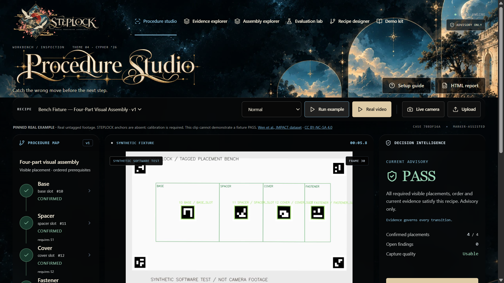
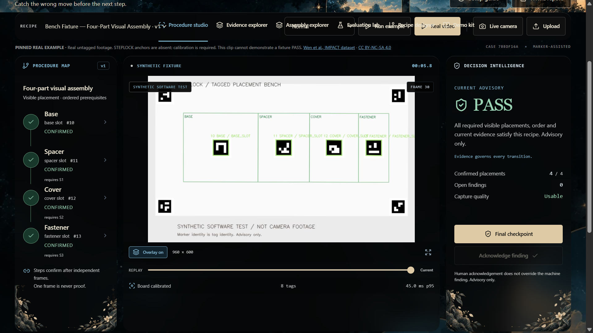
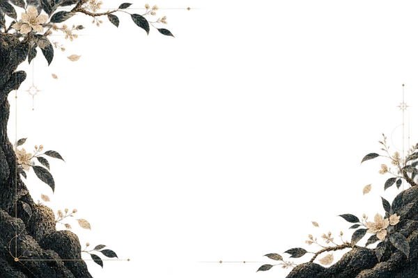
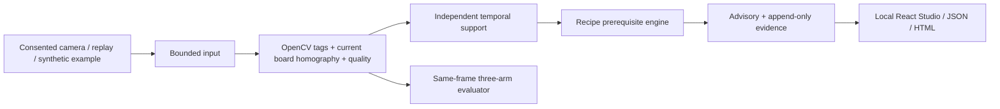

<p align="center">
  
</p>

<p align="center">
  <strong>Catch the wrong move before the next step.</strong><br />
  <sub>Visual procedure assurance · Local evidence engine · Advisory only</sub>
</p>

<p align="center">
  <a href="#run-locally"><strong>Run locally</strong></a> ·
  <a href="#measured-evaluation">Measured evidence</a> ·
  <a href="docs/DEMO_SCRIPT.md">90-second demo</a> ·
  <a href="docs/ARCHITECTURE.md">Architecture</a> ·
  <a href="docs/TECHNICAL_LIMITATIONS.md">Limits</a>
</p>

A local inspection app for a controlled, tagged tabletop assembly. OpenCV reads
actual marker pixels and board anchors. A temporal recipe engine checks visible
placement, prerequisites and correction; findings point to source-frame evidence.

**ADVISORY ONLY.** No machinery interlock, intrinsic part identity, fastening,
torque, fatigue diagnosis, accident-prevention guarantee or safety certification.

<p align="center">
  <a href="screenshots/readme/studio-native.png"></a>
  <br /><sub>Native lossless PNG of the working UI (<code>7352088</code>), showing an observed PASS on the synthetic fixture. <a href="screenshots/readme/studio-native.png">Open the 1920 × 1080 original</a> for full-size text. The fixture is generated test evidence, not physical camera validation.</sub>
</p>

<details>
  <summary>Inspect the procedure, source watermark and advisory at full resolution</summary>
  <p><a href="screenshots/readme/inspection-native.png"></a></p>
  <p><sub>Inspection view after scrolling in the same actual session. No sharpening, upscaling or generated replacement pixels. <a href="docs/README_SCREENSHOT_PROVENANCE.md">Capture provenance</a>.</sub></p>
</details>

## From pixels to proof

<table>
  <tr>
    <td align="center" width="33%">
      <br />
      <strong>01 · Observe</strong><br />
      Read pixels and anchors.
    </td>
    <td align="center" width="34%">
      <br />
      <strong>02 · Verify</strong><br />
      Check placement and order.
    </td>
    <td align="center" width="33%">
      <br />
      <strong>03 · Preserve</strong><br />
      Keep frames and hashes.
    </td>
  </tr>
</table>

<p align="center"><sub>The window, flower and foliage are existing REQUIEM interface artwork. The large capture above is the working product.</sub></p>

The current REQUIEM theme uses the supplied celestial-arch assets, with the real
inspection controls and unaltered source evidence. The current frosted-panel pass
keeps those controls readable without hiding the inspection workspace. [Implementation and validation](docs/REQUIEM_UI_IMPLEMENTATION.md) · [current Git checkpoints](docs/REQUIEM_UI_PROGRESS.md).
The Assembly Explorer has its own tab beside Evidence Explorer. The compact
Celestial masthead, logo and scenic workspace scroll beneath the pinned navigation.
[Current header and responsive verification](docs/REQUIEM_COMPACT_HEADER.md).

Reviewer path: [quick start](#run-locally) · [measured results](benchmarks/runs/20261029_065156_263419_test/summary.md)
· [real physical-video experiment](docs/IMPACT_PHYSICAL_RESULTS.md)
· [acceptance](docs/ACCEPTANCE.md) · [limitations](docs/TECHNICAL_LIMITATIONS.md)
· [authentic push checkpoints](docs/DEVELOPMENT_LOG.md).

## Exact problem anchor

Fresh project for **CYPHER-DigiWeek 2026, J.C. Bose University, YMCA, Faridabad —
Theme 04: Intelligent Mistake Prevention & Systemic Safety**. The team supplied
this theme wording from the organizer graphic:

> Explores how simple human oversights, fatigue, and mismatched physical components
> lead to dangerous or costly real-world accidents. Focuses on the challenge of
> detecting procedural errors, hazardous cross-device configurations, and unsafe
> actions in real time before damage occurs, without slowing down the user’s workflow.

STEPLOCK implements component-tag mismatches, placement mistakes, staged order
constraints and nonintrusive human advisories. It does not diagnose fatigue or
claim real accident prevention. Additional official challenge detail was not
independently retrieved. [Problem alignment](docs/PROBLEM_ALIGNMENT.md).

The latest organizer message relayed by the team requires a new repository and
consistent hourly commits, with judging around 16:30 IST. We retain a stricter
45-minute push cadence and 16:00 internal handoff target. [Rules](docs/COMPETITION_RULES.md).
The repository began today with a README; no older project history or REFLEX code
was imported. Team-member details were not supplied.

## Implemented scope and evidence boundary

- Real ArUco decoding, four-anchor homography and normalized board zones.
- Independent timed support; repeats cannot confirm a step. Missing anchors,
  occlusion, history gaps and uncertain order produce conservative advisories.
- Wrong component/zone/order, missing-at-checkpoint, correction and immutable events.
- Browser Studio, live transport, bounded upload/replay, versioned recipes,
  original/overlay Evidence Explorer, scrubbing and JSON/HTML reports.
- Printable kit, eight small example videos, reproducible 48-clip synthetic suite,
  actual three-arm benchmark and 14 synthetic degradation checks.

**REAL_STAGED_DATA: NOT_PROVIDED. Physical webcam operation: NOT_TESTED.** Camera
transport was exercised with generated JPEGs; procedurally scored data remains
generated video. These scores do not establish factory validity.

**Public physical recordings tested:** the official IMPACT sample was downloaded
and checksum/CRC verified. The unchanged engine processed 2,700 real frames from
15 videos across 45 bounded windows: zero decode failures, 45 calibration refusals,
zero unsupported PASS. Native mistake accuracy is **NOT_SCORABLE** because these
untagged assemblies do not supply STEPLOCK's fixture anchors/part observations.
Offline real-video detector p95 was 27.44 ms; live capture-to-alert latency remains
unmeasured. [Measured report, predictions and limits](docs/IMPACT_PHYSICAL_RESULTS.md)
· [recording kit and reproducible commands](docs/PHYSICAL_VALIDATION.md).

## Run locally

Tested on Windows with Python 3.14.6, Node 24.18.0 and OpenCV 4.14.0. Intended
prerequisites: Python 3.12+ and current Node LTS; other environments are unverified.
Initial installation needs internet. Later runs use local assets without accounts,
API keys, cloud services or downloaded models.

```powershell
git clone https://github.com/Yoriichi-GOD/steplock.git
cd steplock
python scripts/dev.py --setup
```

Open **http://127.0.0.1:62327/**. The launcher now uses this fixed address and
reuses an existing STEPLOCK server on repeat launch. An unrelated app occupying
the port produces a clear error; STEPLOCK never silently switches to a random
address. No camera starts automatically. Subsequent offline launch:
`python scripts/dev.py`. On Windows, double-click **Start STEPLOCK.cmd** to start
the app and open its address. Keep its server terminal open while using the app.

Headless fallback with actual evidence saved locally:

```powershell
.\.venv\Scripts\python.exe scripts/run_demo.py --replay fixtures/synthetic/fx_00_00.avi
```

Use `.venv/bin/python` on Linux/macOS (not tested here). An explicit `--port`
override is available for isolated tests; `--port 0` deliberately requests a
temporary test address. The launcher reads environment variables, not an automatic dotenv
file; see `.env.example`. Built frontend and API share one origin. For separate
Vite development, set `STEPLOCK_API_ORIGIN` to the printed backend URL and explicitly
configure its actual browser origin in `STEPLOCK_ALLOWED_ORIGINS` before launching.

## Demo and physical setup

When the locally acquired IMPACT excerpt is installed, **Real video** is pinned
beside **Run example**. It replays 12 seconds of actual reassembly footage through
the existing inspection pipeline. Its visible label is **REAL VIDEO · UNTAGGED**;
without the fixture anchors it correctly reports **CALIBRATION REQUIRED**, and
does not request a procedure checkpoint automatically. Synthetic examples remain
in the separate selector. No replay or camera starts on page load.

The optional clip stays in ignored `data/external/impact_v1_1/presentation_excerpt/`;
its source/hash/derivation receipt is local. It is not distributed with this MIT
code. The UI retains IMPACT attribution and **CC BY-NC-SA 4.0** context. Missing or
changed clip bytes hide the real-video button and return an explicit API error
if requested; they are never replaced with generated video.

1. **Run example → Normal.** Actual pixels produce tag/zone overlays and confirmed
   graph steps. The included replay requests a final checkpoint at its end.
2. **Wrong Component / Wrong Order.** Inspect exact reason, source time and frame.
   Order is accused only when earlier evidence supports the missing prerequisite.
3. **Correction.** Wrong tag is removed, correct tag appears, CORRECTED links to the
   retained original finding. Acknowledging a warning does not override it.
4. Click an event for original/overlay/hash evidence; export JSON or HTML.
5. Open **Evaluation lab** for measured counts and baselines. [90-second script](docs/DEMO_SCRIPT.md).

All bundled examples visibly say **SYNTHETIC SOFTWARE TEST**. Example names,
filenames and expected-label files are not prediction inputs.

Print [board](demo_kit/printable_board.png) and [marker sheet](demo_kit/markers.png)
landscape without stretching. Fixed anchor centers 40/41/42/43 define TL/TR/BR/BL.
Tags: 10 BASE, 11 SPACER, 12 COVER, 13 FASTENER; 14 wrong type; 30 unknown. Preserve
white borders. Start empty and pause at least half a second between placements.

**Live camera** requires explicit consent; no audio is captured. Permission denial
has an upload fallback. **Upload** declares real recording vs generated imagery,
requires permission and validates content, size, duration and path. Limits: 50 MiB,
120 seconds, decoded dimensions up to 1920px per side. Request a checkpoint after
an uploaded replay. Recording provenance is user-declared, not certified.

[Capture/label protocol](fixtures/recorded/README.md) and `scripts/record_clip.py`
/ `register_recording.py` support consented real footage. Media, uploads and runtime
evidence stay out of Git. Public redistribution needs separate consent.

## Measured evaluation

Final verification run: **32 held-out synthetic clips / 864 decoded frames**, transform
groups 2–5. The 16 development clips and earlier failures remain available.

| Method | Exact final status | Event precision / recall / F1 | False PASS | Timely mistakes |
|---|---:|---:|---:|---:|
| Last observed frame | 24/32 | 1.000 / 0.533 / 0.696 | 8/24 | 12/16 |
| Temporal stable | 28/32 | 1.000 / 0.800 / 0.889 | 4/24 | 12/16 |
| STEPLOCK constraints | 32/32 | 1.000 / 1.000 / 1.000 | 0/24 | 16/16 |

Vision processing p50/p95 **17.4 / 23.5 ms**; offline shared vision + all three
engines/logging **43.4 frames/s**. Capture-to-visible-alert latency and idle/active
CPU overhead were **NOT_MEASURED**. Generated cases share a renderer/recipe and do
not establish industrial generalization. Event F1 covers four declared mistake
classes; uncertainty is separate. The false-PASS denominator includes all 24
non-PASS clips, including insufficient-evidence cases. Zero denominators are null.

```powershell
.\.venv\Scripts\python.exe scripts/make_demo_board.py
.\.venv\Scripts\python.exe scripts/create_fixtures.py --seed 2626
.\.venv\Scripts\python.exe -m pytest -q
.\.venv\Scripts\python.exe scripts/run_eval.py --split test
.\.venv\Scripts\python.exe scripts/run_stress.py
cd frontend
npm ci
npm run build
```

Each benchmark saves a new directory with config, environment, source hashes, raw
observations/events, per-clip scores, latency and retained failures. Only eight
small example AVIs are tracked; regenerate all 48 locally. Truth stays separate
from inference. [Protocol](docs/EVALUATION_PROTOCOL.md) · [development tuning](docs/DEVELOPMENT_TUNING.md).

The first scored run remains unchanged at `20261029_061625_048928_test`; the final
run `20261029_065156_263419_test` uses committed prediction source `0a00d99`.
The optional [assembly explorer](docs/ASSEMBLY_VIEWER.md) illustrates recipe roles
with selectable parts and a 2D fallback. It cannot change an inspection verdict.


## Architecture and sources



FastAPI routes cover health, recipes, sessions, upload/start/stop/checkpoint/review,
frames/events/reports and measured benchmark artifacts. Session capability tokens
travel in headers and are omitted from exports. [Architecture/API](docs/ARCHITECTURE.md).

Code: [MIT](LICENSE). Dependencies/datasets retain their terms. Assembly101
annotation-only inventory: **328 CSVs / 3,964 rows**, CC BY-NC 4.0, no raw video.
Only [inventory metadata](docs/ASSEMBLY101_INVENTORY.json) is published. Its action-label
and visual benchmarks are NOT_RUN because no defensible recipe mapping exists.
HoloAssist/IKEA ASM are references, with no trained model, bulk video download or
claimed score. [Data sources and attribution](docs/DATA_SOURCES.md).

Tags identify labels, not intrinsic parts. Swapped labels, uniform occluders and
hidden stacked objects defeat assumptions. Unobserved is not automatically absent;
white-board emptiness is a constrained heuristic. No fastening, torque or physical
safety is verified. [Limits](docs/TECHNICAL_LIMITATIONS.md) · [validation receipts](docs/VALIDATION.md)
· [capability truth table](docs/CAPABILITY_TRUTH_TABLE.md). **ADVISORY ONLY.**
