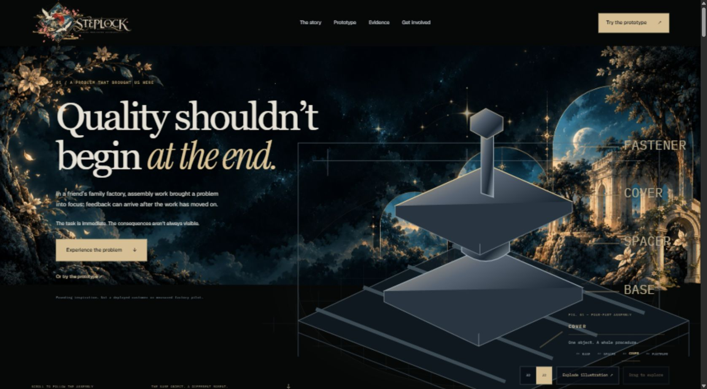
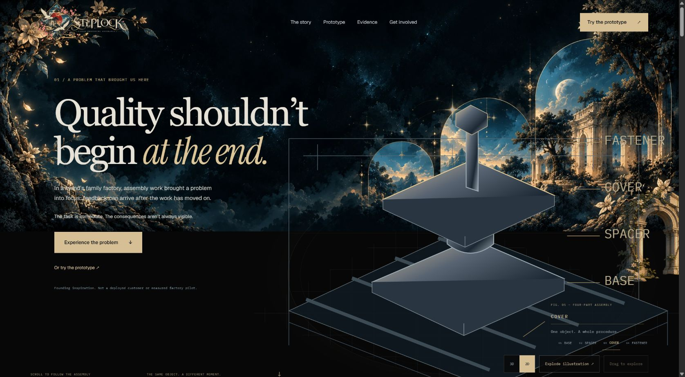
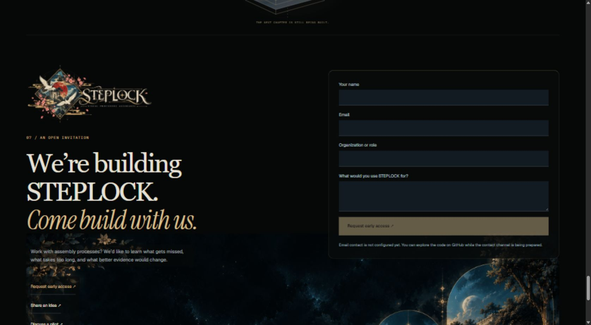
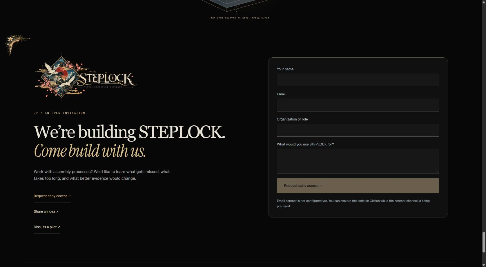
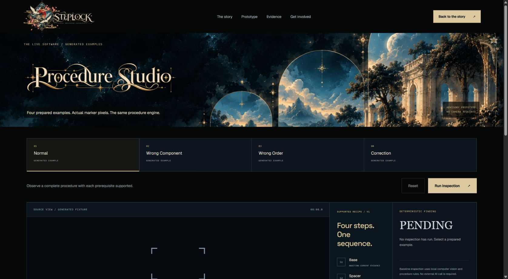
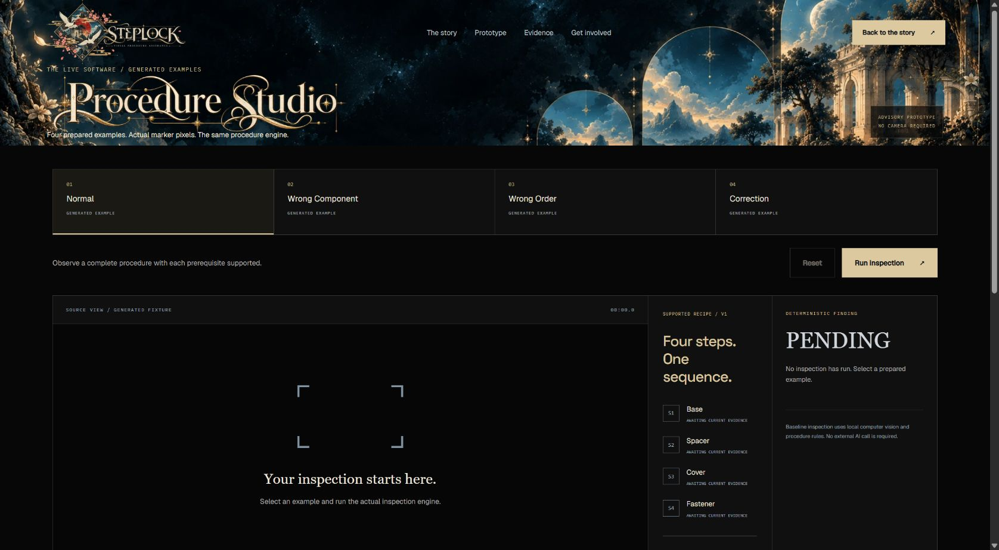

# Black theme and transparent masthead correction

Follow-up: [REQUIEM composition correction](REQUIEM_COMPOSITION_CORRECTION.md) supersedes the fragment placements and closing-section composition below following the user's marked review.

User-requested follow-up to `e12bf3f`, implemented locally on 2026-11-01. Preview remains <http://127.0.0.1:62401/> and the generated-example demo remains `/demo`.

## What changed

The navigation previously had transparent CSS over a solid page background because the scenic artwork began below it. The masthead now shares the artwork's exact coordinates with the hero: the scene begins at page y=0 and continues behind the navigation. The navigation has zero background alpha, no backdrop blur and no shadow. The supplied artwork retains its colors and opacity.

Desktop demo composition now follows the compact source measurements: 110px navigation plus a 138px heading area, totaling 248px. The mobile demo uses a deliberate portrait framing of the full celestial artwork. Logos, title artwork, links and buttons remain separate React elements.

Large page surfaces are neutral black: page `#070707`, inspection panels `#101010`, inputs `#171717`. The large roadmap statement is neutral gray. Blue remains on small technical accents and in the supplied scenic artwork; inspection images and existing assembly materials are unchanged.

The closing invitation uses a black field and a matched upper-left/lower-right ornamental frame. Its scenic wallpaper and free-floating marketing flower were removed. Original artwork files are preserved. The closing text, contact choices, form and configuration behavior remain intact.

## Ornament placement

The supplied decorations now follow content structure rather than loose screen coordinates:

| Chapter | Placement |
| --- | --- |
| Entrance | Original celestial scene, crest/wordmark, outer grand arch and one sparkle cluster. |
| Knowledge gap | Fluted column and floral-vine divider grouped as one chapter transition. |
| Late feedback | Broken arch attached beside the first process-station annotation, clear of the consequence text. |
| Product reveal | Architectural corner attached to the illustrative diagnostic panel; halo-star chapter divider. |
| Prototype | Existing paired landscape windows around the authentic application preview, introduced by the mountain-crest divider. |
| Evidence | Restrained crescent divider; inspection results remain dominant. |
| Roadmap | Twin arches share a grid row with the heading, clear of the chapter label; celestial-diamond divider above. |
| Invitation | Matching ornamental corners frame the full contact section, with the complete STEPLOCK wordmark. |

Thirteen distinct optimized kit assets now appear across the public experience. All 18 supplied originals and their optimized derivatives remain available. Larger fragments hide on phones; chapter dividers and the closing frame remain. Decorative elements ignore pointer input and are hidden from assistive technology.

New chapter ornaments are static. Existing GSAP pane entrances and heading/story animations remain, as does the bounded sparkle glint. Reduced-motion behavior is preserved. The unrelated marketing flower animation was removed.

## Exact source changes

- `frontend/src/styles/requiem-landing.css`: continuous scenic masthead, neutral palette, compact demo positioning, chapter group layouts, responsive clearances and closing frame.
- `frontend/src/components/marketing/RequiemDecorations.tsx`: reusable chapter-specific ornament groups; removes the marketing flower component.
- `frontend/src/components/marketing/CinematicStory.tsx`: attaches ornaments to the chapter divider, process annotation and illustrative diagnostic panel.
- `frontend/src/components/marketing/PublicChrome.tsx`: replaces the closing flower with the matched section frame.
- `frontend/src/pages/LandingPage.tsx`: places the roadmap artwork beside its heading in normal grid flow.
- `frontend/src/theme/theme.test.mjs`: expands the existing text-encoding regression check to story and public chrome copy after a temporary encoding issue was caught and corrected.

This report, a follow-up note in the previous report, and `screenshots/requiem-black-refinement/` contain the documentation and browser receipts. Assembly renderers/adapters, story-state logic, APIs, engine, routing, infrastructure and the private Studio layout are unchanged. Unrelated `docs/judging/` work is preserved.

## Verification

| Requirement | Evidence |
| --- | --- |
| Transparent taskbar over artwork | Rendered background `rgba(0,0,0,0)`, backdrop `none`, scene starts at y=0; desktop/phone screenshots. |
| Neutral black theme | Computed page RGB 7/7/7 and demo panel RGB 16/16/16. |
| Composed closing section | No closing scenic pseudo-background or marketing flower; matching corners, usable contact choices and honest disabled submission. |
| Ornaments respect content | Desktop chapters visually inspected; grouped roadmap heading and transition cap; broken arch cleared of text. |
| Responsive layout | Settled checks at 1691, 1280, 1024, 390 and 320px widths: zero horizontal overflow. |
| Frontend regression suite | 26 passed; production build and TypeScript passed. |
| Public-demo backend regression suite | 8 passed in 36.63 seconds; one existing upstream Starlette/httpx deprecation warning. |
| Real browser workflow | Normal generated example reached PASS; wrong component held for review; Reset returned PENDING. Phone demo navigation and contact-purpose selection worked. |

Backend command: `.venv/Scripts/python.exe -m pytest backend/tests/test_public_demo.py -q --basetemp=C:/Users/nrgen/AppData/Local/Temp/steplock-requiem-black-20261101-1950 -o faulthandler_timeout=45`. The previous report retains its historical full-suite run; this follow-up reran the relevant public-demo suite. Vite's existing large shared 3D chunk warning remains. These checks do not measure physical factory accuracy or GPU performance.

## Actual browser comparison

Before images are retained captures from `e12bf3f`. After images show this correction. These are browser JPEGs; the capture excludes browser chrome/scrollbars. Capture dimensions and hashes are recorded in `screenshot-manifest.json`; viewport and computed-style receipts are in `responsive-audit.json` and `validation.json`.

| View | Before | After |
| --- | --- | --- |
| Taskbar and hero |  |  |
| Closing invitation |  |  |
| Demo entrance |  |  |

Phone captures: [header](../screenshots/requiem-black-refinement/header-390.jpg), [invitation](../screenshots/requiem-black-refinement/invitation-390.jpg), [demo](../screenshots/requiem-black-refinement/demo-390.jpg). Separate screenshots document each decorated chapter and actual generated inspection results.
