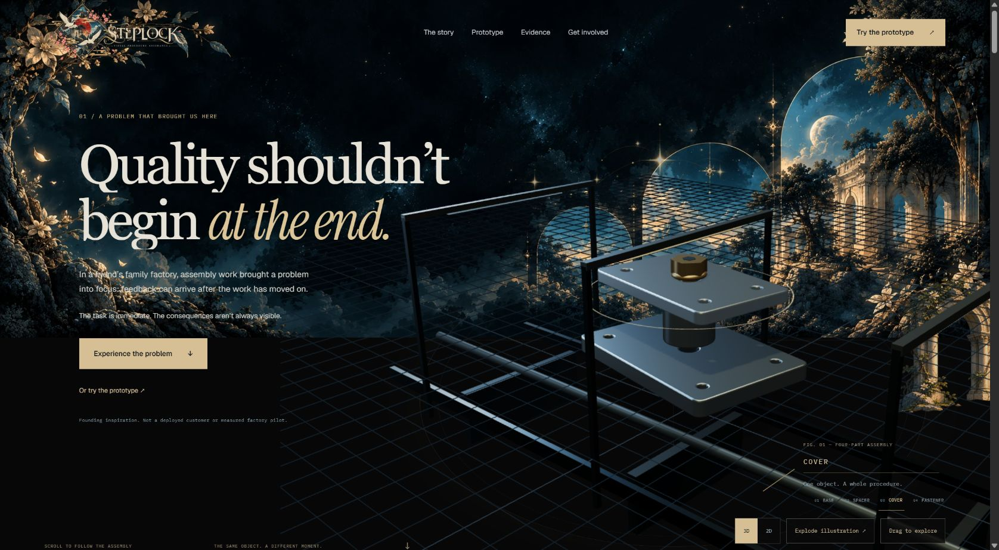
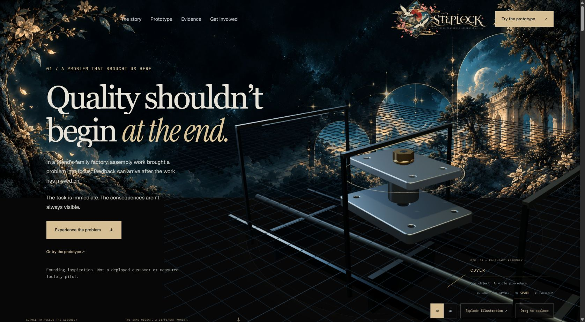
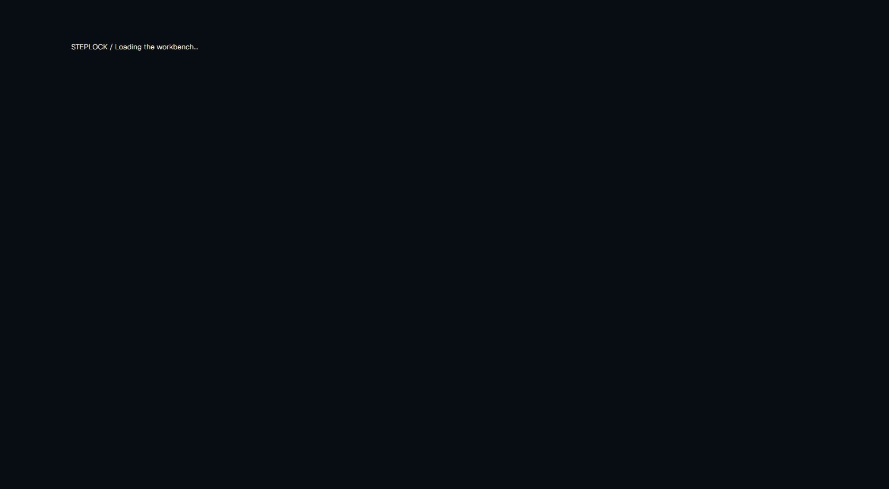
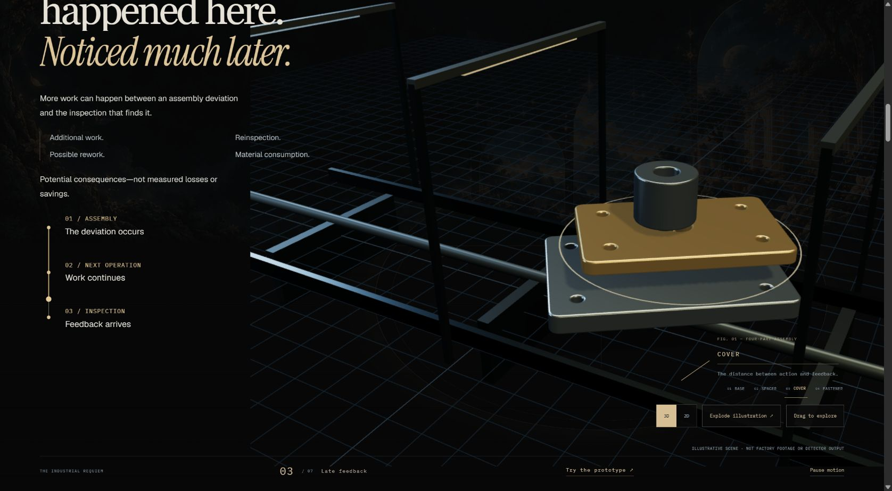
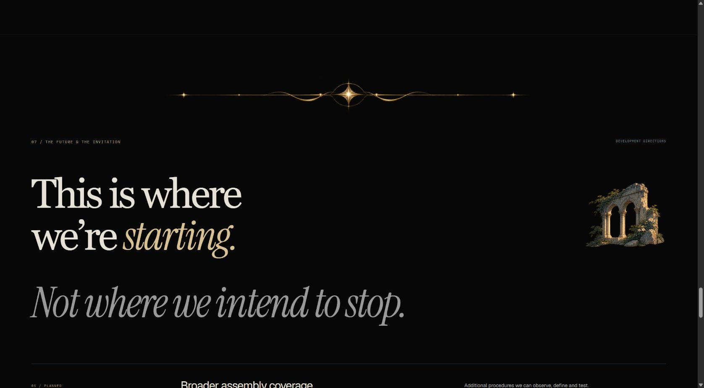
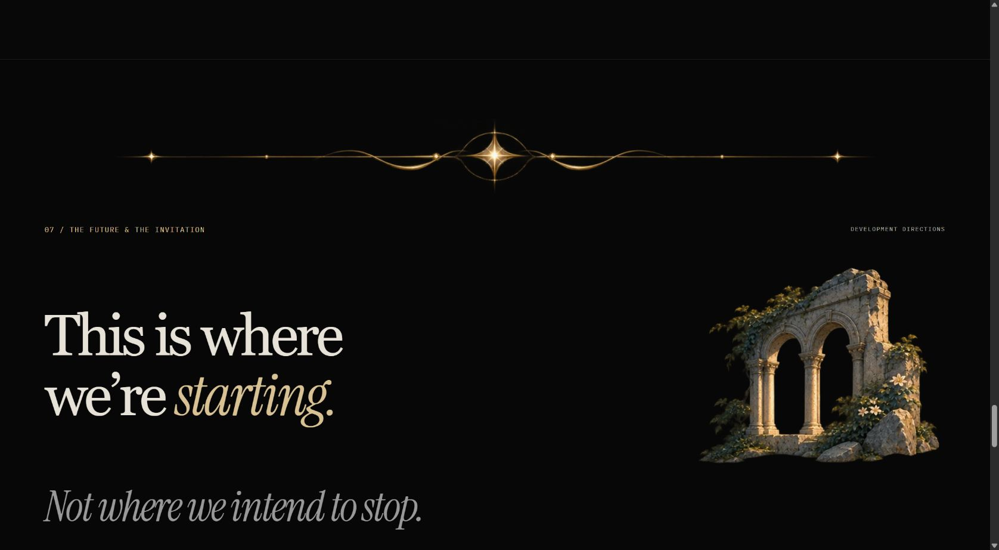
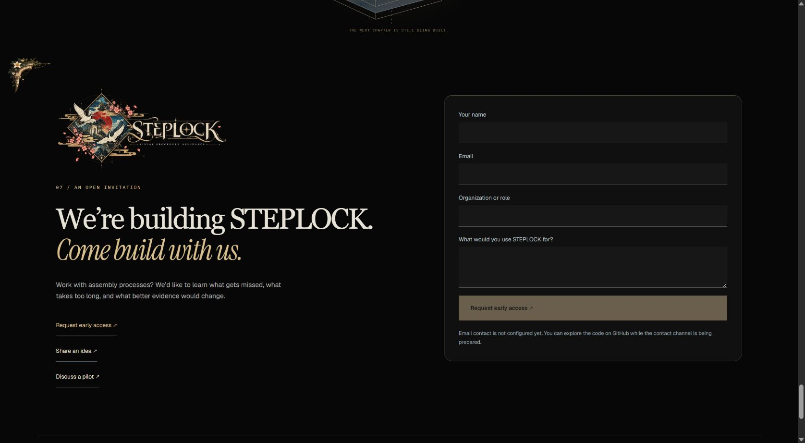
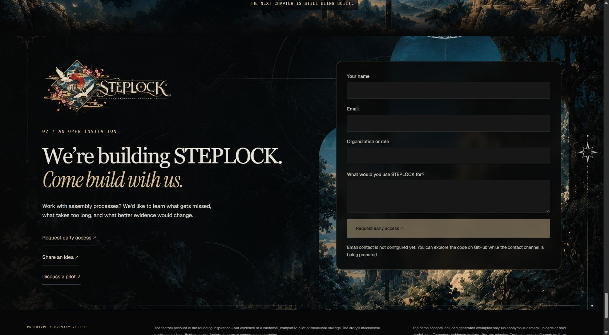
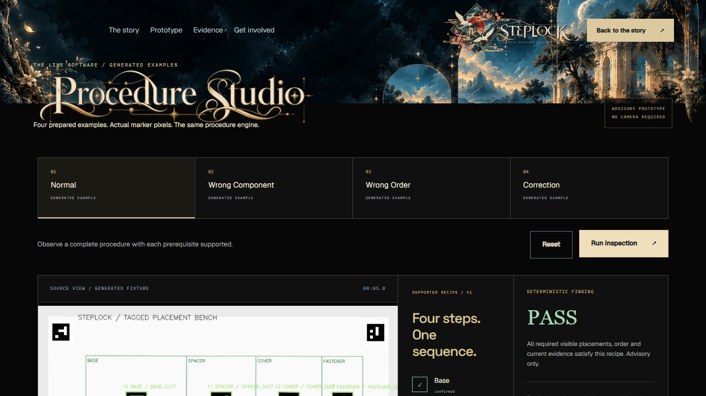

# REQUIEM composition correction

Follow-up: [Phone illustration dock and fixed local startup](REQUIEM_MOBILE_DOCK_AND_LOCAL_STARTUP.md) implements the user's later phone-layout request and replaces the temporary Windows preview launch setting with a launcher default.

Implemented and browser-reviewed on 2026-11-01. Preview remains http://127.0.0.1:62401/; working generated-example demo: `/demo`. This follows the user's marked screenshots and supersedes the previous fragment placements and black-only closing composition.

## Finished changes

- Removed the detached grand arch from the hero, the small fluted column beside the knowledge divider, and the broken arch beside the process stations. Source artwork is preserved.
- Moved the complete STEPLOCK logo beside the prototype button, clear of the hero's left floral cluster. Its desktop display width is 280px, with smaller responsive sizes. Navigation remains fully transparent.
- Enlarged the chapter dividers to a maximum 1320px. The floral story transition remains in the left text region without a column attached to it.
- Reworked the existing process annotation into a vertical ordered list inside the left story column. The same GSAP draw/traveler animation follows a vertical path; its static starting position also works with reduced motion.
- Increased chapter-label contrast and size, explanatory copy, and the illustrative diagnostic heading.
- Added a neutral black backing behind phone story copy after normal-motion browser QA caught the sticky assembly showing through scrolling text. The illustration and its controls remain intact.
- Enlarged the roadmap's twin arches to 430px at the reviewed desktop width, within the 488px source width. The ornament occupies a dedicated heading-grid column. Phones retain a smaller architectural companion.
- Tightened roadmap rows and the space before the final assembly. The assembly now occupies a separate compact scenic scene, centered within the original Celestial artwork, directly above the invitation.
- Restored `celestial-arches.webp` behind the complete invitation. A local text-side gradient and neutral translucent form protect readability while the architecture remains visible on the right. The page's large surfaces remain neutral black.

## Artwork and motion

Existing optimized assets were reused: `celestial-full.webp`, `celestial-arches.webp`, the complete ornate logo, twin arches, ornate upper corner, celestial sparkle cluster, floral-vine, halo-star, mountain-crest, crescent-moon and celestial-diamond dividers. Existing prototype window panes, compact demo background and Procedure Studio title artwork remain. No artwork was regenerated, recropped or deleted; no dependencies were added.

Existing Three.js scenes, 2D fallback, assembly selection/explode controls, story state, GSAP section transitions, pane entrances and bounded sparkle animation remain. No new continuous animation was introduced. Only the process path and its annotation layout changed. Decorative layers remain non-interactive and hidden from assistive technology. Evidence images receive no visual filters.

## Exact implementation files

1. `frontend/src/components/marketing/PublicChrome.tsx` — header logo order beside the CTA; contact behavior unchanged.
2. `frontend/src/components/marketing/RequiemDecorations.tsx` — removed the three marked placements; scenic invitation.
3. `frontend/src/components/marketing/CinematicStory.tsx` — vertical ordered process annotation; removed obsolete fragment calls.
4. `frontend/src/pages/LandingPage.tsx` — compact scenic assembly scene before the existing invitation.
5. `frontend/src/styles/requiem-landing.css` — responsive composition, ornament scale, readable labels, neutral surfaces and closing scenery.

Documentation and actual browser receipts are in this report, a follow-up link in the prior report, and `screenshots/requiem-composition/`. The architecture-owning chat was notified before edits and held these presentation files and port 62401. Renderers, state adapters, engine, APIs, routes, infrastructure, private Studio and unrelated `docs/judging/` work were preserved. `day1-final` was not moved.

## Definition of Done and verification

| Requirement | Verified result |
| --- | --- |
| Remove marked random fragments | Hero and process/reveal captures show their removal; no source assets deleted. |
| Larger dividers and roadmap architecture | Desktop captures; measured divider 1320px and roadmap art 430px. |
| Vertical process and retained motion | Start, middle and end positions measured at 0%, 48.53% and 100%; horizontal alignment error under 0.001px. See `traveler-audit.json`. |
| Transparent masthead and black surfaces | Computed navigation `rgba(0,0,0,0)`; demo panels RGB 16/16/16. |
| Responsive layout | Real browser inspected at 1691×930, 1280×720, 1024×768, 390×844 and 320×740. Document scroll width equals client width at each size. See `responsive-audit.json`. |
| Frontend | TypeScript and production build pass; 26 existing frontend tests pass. |
| Backend | 8 public-demo regression tests pass in 34.19s. |
| Product behavior | Real generated normal inspection reached PASS with 30 frames and 10 events; Reset returned PENDING. Wrong-component replay reached HOLD FOR REVIEW with 30 frames and 11 events. 3D/2D switching, component selection and explode/assemble controls worked. Contact-purpose selection worked; unconfigured submission stayed disabled. |

Commands: `npm run build`, `npm test`, and `.venv/Scripts/python.exe -m pytest backend/tests/test_public_demo.py -q --basetemp=C:/Users/nrgen/AppData/Local/Temp/steplock-requiem-composition-20261101-verified -o faulthandler_timeout=45`.

The restricted backend run stalled while creating a Windows local socket and was stopped; the normal-networking rerun above passed. Existing warnings remain: Vite's large shared 3D chunk and an upstream Starlette/httpx deprecation. These are functional and visual checks, not a GPU benchmark or physical-factory validation. The full backend suite was not rerun for this presentation-only change.

## Actual before and after

Before captures below are retained from the previous committed composition. After captures show this correction. Screenshots are browser JPEGs. Their actual raster sizes and SHA-256 hashes are recorded in `screenshots/requiem-composition/screenshot-manifest.json`; browser viewport dimensions are recorded separately because browser chrome, scrollbars and host display scaling affect capture dimensions.

| View | Before | After |
| --- | --- | --- |
| Hero and logo |  |  |
| Process |  |  |
| Roadmap |  |  |
| Invitation |  |  |

Additional inspected views: [scenic assembly](../screenshots/requiem-composition/formation-1691.jpg), [mountain divider](../screenshots/requiem-composition/prototype-1691.jpg), [crescent divider](../screenshots/requiem-composition/evidence-divider-1691.jpg), [product reveal](../screenshots/requiem-composition/product-1691.jpg), [working demo](../screenshots/requiem-composition/demo-normal-1691.jpg).

Phone views: [hero](../screenshots/requiem-composition/hero-390.jpg), [roadmap](../screenshots/requiem-composition/roadmap-390.jpg), [assembly](../screenshots/requiem-composition/formation-390.jpg), [invitation](../screenshots/requiem-composition/invitation-390.jpg). Layout acceptance is based on these rendered pages, not the build alone.

Normal-motion phone scrolling also has a specific regression comparison: [before local text backing](../screenshots/requiem-composition/before-phone-copy-backing.jpg) and [corrected readable process](../screenshots/requiem-composition/process-stops-390.jpg). All three station rows are visible between y=333 and y=533 in the corrected 844px viewport. The clean [floral knowledge transition](../screenshots/requiem-composition/knowledge-1691.jpg) documents the removed column.

## Independent review and preview-runtime follow-up

The architecture-owning agent independently accepted presentation commit `2dd421ba1af6b3e0f436cb26d8c448d0cead350b`: all five viewport widths, vertical traveler alignment, all 24 capture hashes and 26 frontend tests passed. The full [exact-commit CI run](https://github.com/Yoriichi-GOD/steplock/actions/runs/41331567398) also completed successfully.

A later fresh demo run exposed an existing runtime issue after a prior session expired. `POST /api/public/demo/sessions` called `cleanup → remove → shutil.rmtree`, which raised `PermissionError: [WinError 5] Access is denied` on an expired session's `frames` directory under the OneDrive checkout's `runtime/public_demo/sessions/`. The UI correctly stayed PENDING with an error banner; it did not retain a stale PASS. The traceback proves a filesystem cleanup failure; the specific Windows process holding the directory was not identified.

The preview was restarted on the same **62401** address using the existing `STEPLOCK_RUNTIME` setting pointed outside OneDrive. No application, API, engine, cleanup semantics or deployment code changed. The previous OneDrive runtime was preserved. The following is the tested launch configuration from the repository root in a normal local PowerShell terminal:

```powershell
$env:STEPLOCK_PUBLIC_MODE = '1'
$env:STEPLOCK_RUNTIME = 'C:\Users\nrgen\AppData\Local\Temp\steplock-public-preview-62401'
.\.venv\Scripts\python.exe scripts/dev.py --port 62401
```

Retain this runtime setting for the synced checkout. The application's default `ROOT/runtime` setting was not changed; the environment correction applies to this local preview.

After restart, the independent real-browser check passed **PENDING → Normal PASS → Reset PENDING**, with 30 analyzed frames and 10 events. No failed API responses or page errors were observed; source-image filter remained `none` and opacity `1`. A newly created disposable orphan with an age beyond the 600-second TTL was then removed by the running server in **4.41 seconds**, verifying expiry cleanup in the actual external runtime. The first probe accidentally used the tooling process's different temporary directory and was discarded as a configuration mismatch; the accepted probe used the exact server path above.

The [independent presentation review](../screenshots/requiem-composition/runtime-followup/independent-presentation-review.json), [original runtime error](../screenshots/requiem-composition/runtime-followup/before-runtime-error.json), [restored browser result](../screenshots/requiem-composition/runtime-followup/restored-preview.json), [expiry cleanup receipt](../screenshots/requiem-composition/runtime-followup/expiry-cleanup-restored.json), and their hashes are retained under `screenshots/requiem-composition/runtime-followup/`.


