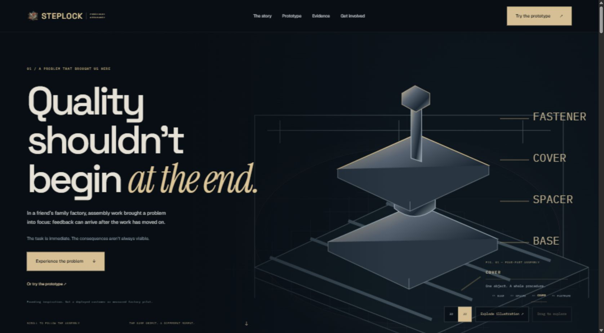
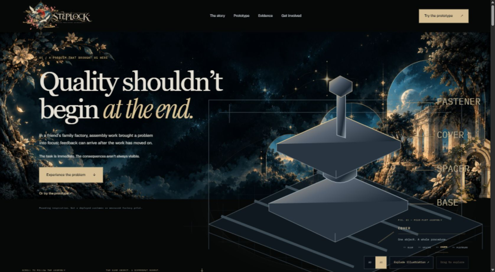
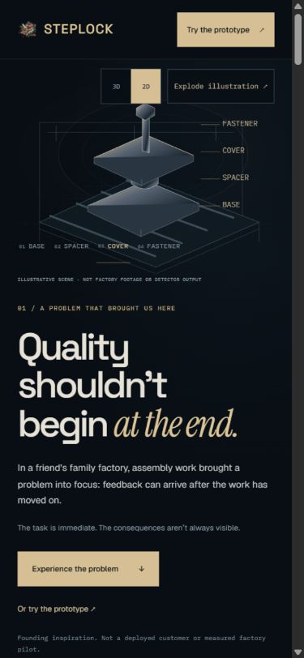
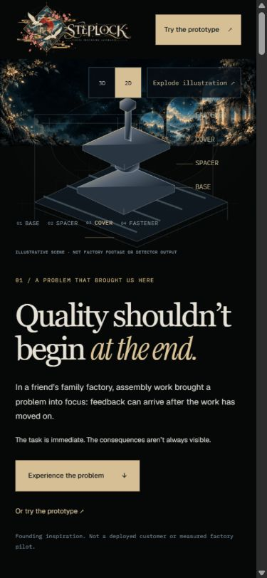
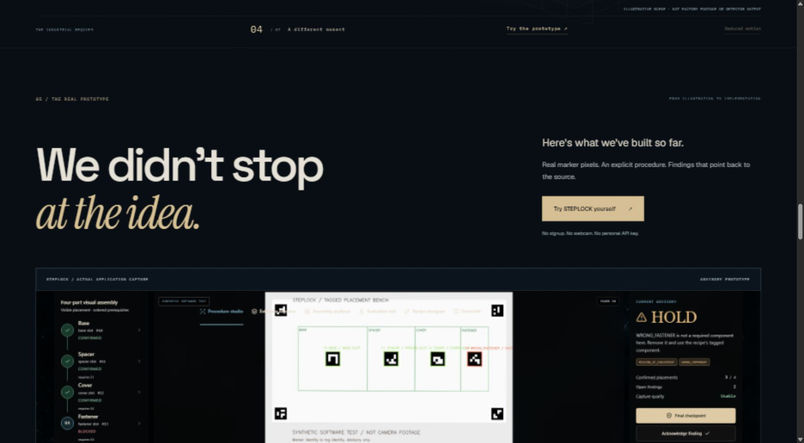
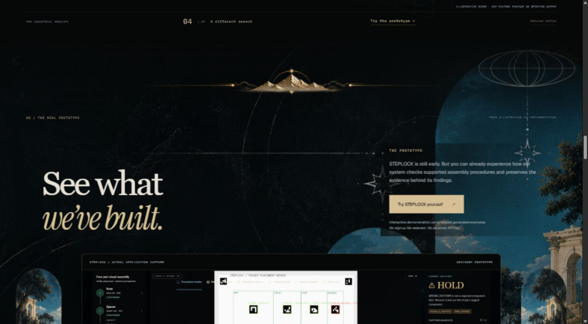
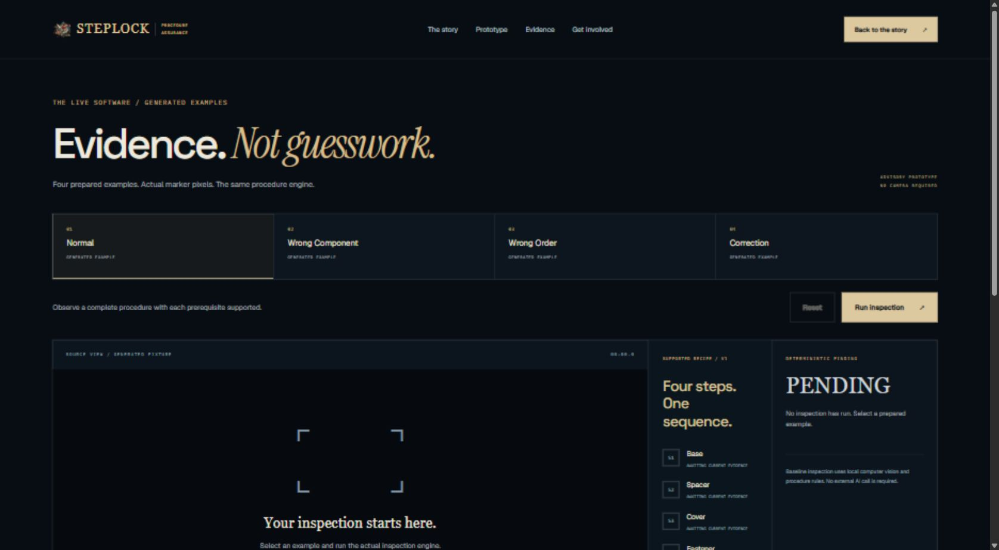
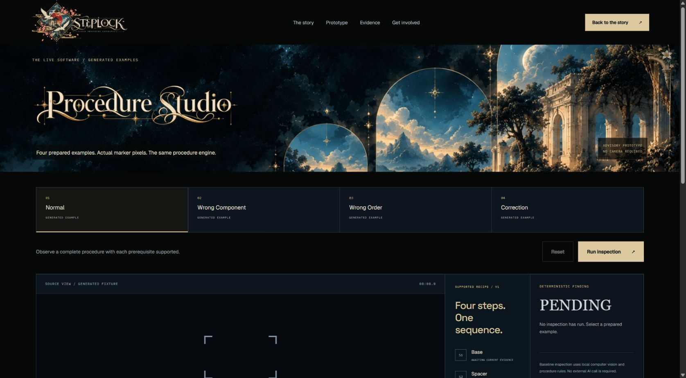

# REQUIEM landing and public demo reintegration

Follow-up visual corrections are documented in [REQUIEM_BLACK_REFINEMENT.md](REQUIEM_BLACK_REFINEMENT.md): transparent navigation over the artwork, neutral black panels, structured chapter ornaments, and a closing frame replacing the wallpaper/flower. The report below retains the original integration checkpoint's history.

Implemented and locally reviewed on 2026-11-01. Preview: <http://127.0.0.1:62401/>; working generated-example demo: <http://127.0.0.1:62401/demo>.

## Ownership and scope

Coordinated with the existing cinematic/assembly agent before editing. The agreed presentation files are the four wrappers below, a new decoration component, CSS and assets. The other agent suspended edits and browser changes during acceptance capture.

The assembly geometry, state adapter, scene renderers, story pose/timeline logic, renderer fallback, routing, session API, heartbeat/reset guards, engine, deployment and Studio layout are unchanged. Decorative side panes return on the public prototype invitation only. No new dependencies, external font requests, WebGL contexts or particle systems were added. The frozen `day1-final` tag was not moved.

## Exact source files

| File | Change |
| --- | --- |
| `frontend/src/components/marketing/RequiemDecorations.tsx` | New reusable scenery, sprite, divider, portal, flower and demo masthead components. Intersection observers pause offscreen artwork; decorations are hidden from assistive technology and ignore pointer input. |
| `frontend/src/styles/requiem-landing.css` | Public-only composition, original-art branding, serif headings, responsive framing, readable local text surfaces and reduced-motion rules. |
| `frontend/src/components/marketing/CinematicStory.tsx` | Adds scenery behind the existing renderer and a quiet chapter divider. Scene logic is unchanged. |
| `frontend/src/components/marketing/PublicChrome.tsx` | Replaces typed replacement branding with the original complete wordmark; adds closing logo and floating floral artwork. Existing contact logic is unchanged. |
| `frontend/src/pages/LandingPage.tsx` | Frames the authentic application capture, updates the prototype invitation, adds chapter ornaments and two one-time GSAP pane entrances. |
| `frontend/src/pages/PublicDemo.tsx` | Adds the compact scenic masthead and original Procedure Studio title, with an accessible text heading. All session and evidence code is unchanged. |
| `.gitattributes` | Preserves the new artwork bytes without text normalization. |
| `frontend/public/assets/requiem-ornaments/manifest.json` | Source ZIP hash, all PNG/WebP hashes, dimensions, byte counts and conversion provenance. |

The asset directory also contains the 18 supplied PNGs, unchanged, and 18 same-size optimized WebP derivatives. Documentation and screenshots live in this report and `screenshots/requiem-reintegration/`. Unrelated `docs/judging/` work is excluded.

## Artwork and placements

All four mandatory kit documents were read; all 18 extracted assets were inspected over black and checkerboard. No source sheets were recropped. Existing manifests, REQUIEM implementation notes, theme CSS and historical Studio screenshots informed the composition.

Original artwork reused:

- `steplock-header/celestial-full.webp`: principal hero, original 2149 × 732 proportions, full opacity; returns behind the closing invitation.
- `steplock-header/BACKGROUND_HEADER_READY_1691x248.webp`: compact public demo entrance.
- `requiem/steplock-ornate-logo.webp`: navigation, closing invitation and footer. Existing compact crest remains the favicon.
- `requiem/procedure-studio-ornate-title.webp`: demo entrance title, separate from the background.
- `requiem/celestial-arches.webp` and `right-arch-landscape.webp`: prototype portal and paired side windows. The 300 × 533 windows display at no more than 190 CSS pixels wide.
- `requiem/floating-flower.webp`: restrained closing ornament outside the inspection workspace.

Selected new runtime sprites:

| Supplied family | Used asset | Placement |
| --- | --- | --- |
| Sparkles | `celestial-sparkles-cluster.webp` | One hero cluster; brief glint. |
| Fragments | `fragment-grand-arch.webp` | Partial outer hero edge, hidden on phones. |
| Corners | `corner-upper-left.webp` | Small mirrored demo masthead corner. |
| Dividers | `divider-floral-vine.webp` | Quiet factory/knowledge chapter. |
| Dividers | `divider-mountain-crest.webp` | Prototype reveal. |
| Dividers | `divider-crescent-moon.webp` | Evidence/limits transition. |
| Dividers | `divider-celestial-diamond.webp` | Future/invitation transition. |

All 18 supplied names, including the unused alternatives, are enumerated in the manifest. The four corners, eight fragments, five dividers and one sparkle cluster remain individually reusable. They are user-supplied generated illustrations, not historical source-pack originals or inspection evidence.

The PNGs total 4,753,634 bytes; the WebP derivatives total 1,473,566 bytes (about 69% smaller). Runtime requests use selected WebP files; source sheets are not deployed. Original PNGs remain available under public assets as requested. Artwork dimensions and alpha channels are preserved. This measures file sizes, not rendering speed.

## Motion and pacing

The existing Three.js scenes, Lenis/GSAP story, masked heading reveals, preview tilt and evidence interaction remain. Added pane entrances use the existing GSAP scope, translate 35px inward and fade once over 1.3 seconds. The hero sparkle glints once for 2.4 seconds. The closing flower moves 8px and rotates 2 degrees over a slow five-second alternate cycle, paused outside the viewport. Reduced motion disables these additions.

The celestial world is prominent in the opening and product return, recedes in the knowledge/late-feedback chapters, and returns around the prototype and closing invitation. Evidence content retains its restrained technical layout. No transforms, blur, tint or filters were added to actual inspection pixels.

## Verification

| Check | Result |
| --- | --- |
| `npm run build --prefix frontend` | Passed, including TypeScript. Existing large shared 3D chunk warning remains. |
| `npm test --prefix frontend` | 26 passed. |
| Existing full backend suite | 122 passed in 86.67s; one existing upstream Starlette/httpx deprecation warning. |
| Asset audit | All 18 PNGs match the supplied kit byte-for-byte. All WebP hashes, original dimensions and transparent alpha verified. |
| Desktop/mobile layout | Rendered and inspected at CSS viewports 1691 × 930 and 390 × 844; additional settled checks at 1920, 1280, 1024 and 320px widths. No horizontal overflow or failed visible images. |
| Normal / correction examples | PASS from the actual local engine. Correction retains the original finding. |
| Wrong component / wrong order | HOLD_FOR_REVIEW from the actual local engine. |
| Source / inspection overlay | Both controls display the appropriate retained image. |
| Network interruption after PASS | SOURCE LOST; Reset returns PENDING. Network emulation restored. |
| Assembly controls | BASE selection, explode/assemble, 2D SVG fallback, return to native WebGL and manual orbit visibly work. |
| Contact | Remains disabled while unconfigured; no pretend submission. |
| Ornament safety | Empty decorative alt text, aria-hidden and pointer-events none verified in rendered DOM. Reduced-motion artwork is static; offscreen flower pauses under normal motion. |

Backend command: `.venv/Scripts/python.exe -m pytest -q --basetemp=C:/Users/nrgen/AppData/Local/Temp/steplock-requiem-full-20261101-1910 -o faulthandler_timeout=45`. Initial restricted runs were interrupted after Windows socketpair/temp-file restrictions; the successful run used normal local execution. No engine code was changed to accommodate the environment.

These are local browser and generated-software checks. No new physical-camera validation, factory accuracy measurement, deployment, GPU benchmark or certification is claimed.

## Rendered before / after

The before build comes from `555e4b863e769a7fe14861902a3dee5dac416668`. Matched hero comparisons use reduced-motion 2D rendering to isolate visual changes; a separate native 3D/orbit capture proves the existing interactive scene remains. Screenshots are actual browser JPEGs, not design references or mockups. Requested CSS viewports are recorded in the audit; the browser capture excludes its scrollbar/chrome (desktop JPEG 1676 × 922, phone JPEG 375 × 812).

| View | Before | After |
| --- | --- | --- |
| Desktop hero |  |  |
| Phone hero |  |  |
| Prototype portal |  |  |
| Demo entrance |  |  |

Additional proof: mobile portal/demo, closing invitation, 2D and manual-orbit assembly, all four generated scenarios, connection loss, and responsive screenshots. `asset-audit.json`, `responsive-audit.json`, `validation.json` and `screenshot-manifest.json` retain the machine-readable receipts.

Definition of Done: visual identity integrated; architecture and evidence semantics preserved; desktop/mobile rendering inspected; regression suites pass; source and asset provenance recorded; changes checkpointed separately from unrelated work.
