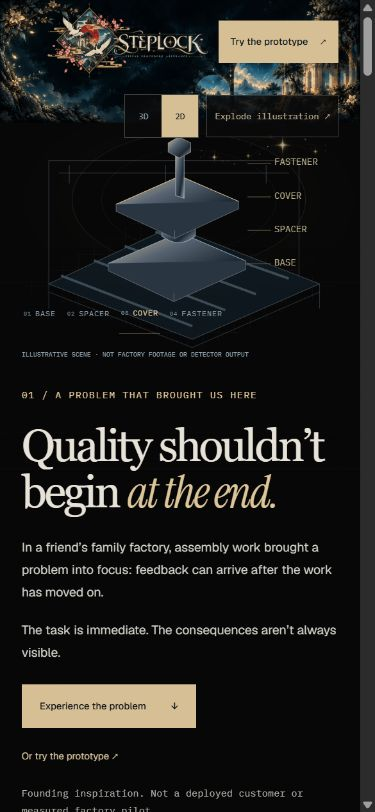
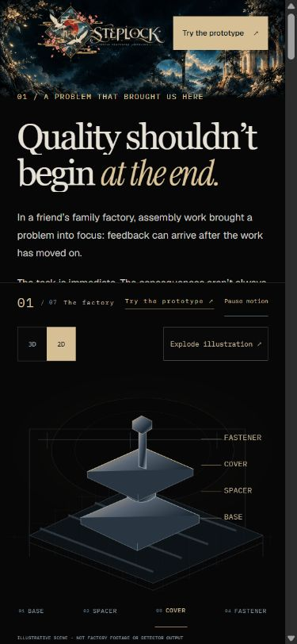

# Phone illustration dock and fixed local startup

Implemented and browser-reviewed on 2026-11-01. The user requested a dedicated lower-half illustration on phones, scrolling text above it, a natural exit when the cinematic story ends, more deliberate navigation wording, and a reliable local address.

## Phone behavior

For widths up to 767px, the existing story stage is sticky inside the cinematic story. Its illustration occupies the lower half of the viewport. The chapter instrument sits immediately above it; the text uses the upper reading area and scrolls behind the dock's opaque black edge. Chapter spacing lets the final text, links and dividers clear the reading area before the stage exits.

The stage remains bounded by the story. It scrolls upward out of view as that story ends, leaving the prototype section unobstructed. No fixed global overlay or additional scroll container was introduced. Existing rendering, pose/state adaptation, GSAP progression and 3D/2D fallback remain unchanged. The same controls are retained. The header stays transparent and the large surfaces remain black.

Actual geometry recorded in `screenshots/requiem-mobile-dock/dock-audit.json`:

| View | Chapter bar | Illustration | Component controls |
| --- | --- | --- | --- |
| 390×844 phone | y=370–422 | y=422–844 | Bottom y=822 |
| 320×740 phone | y=318–370 | y=370–740 | Bottom y=718 |

The 390px measurements remain constant across entrance, scrolled copy, knowledge gap, late feedback and product reveal. During exit, the stage moves with the story boundary; after the story, its bottom is y=-101.8px. All sampled document widths have zero horizontal overflow. Reduced-motion mode retains the lower dock and the 2D illustration without scroll animation. Phone captures cover portrait layouts; physical phone hardware and landscape layouts were not separately validated.

## Navigation

| Label | Existing destination |
| --- | --- |
| Why STEPLOCK | `/#factory` |
| Enter the Studio | `/#prototype` |
| The Record | `/#how-it-works` |
| Get involved | `/#early-access` |

Only the first three labels changed. The complete logo, foreground controls and destination sections remain separate elements. Desktop spacing was inspected at 1691, 1280 and 1024px: navigation, logo and CTA have clear horizontal separation. The header background remains `rgba(0,0,0,0)`.

## One stable local address

The Python launcher, Windows shortcut, Vite development server and Vite production preview now default to **http://127.0.0.1:62401/**. The Python launcher reuses a recognized running STEPLOCK server. Vite's strict-port setting rejects a busy port instead of choosing a different address. Explicit port overrides remain available for isolated tests.

From the repository root:

```powershell
python scripts/dev.py
```

On Windows, `Start STEPLOCK.cmd` uses that same port and opens the address. Its first-run setup behavior is retained. Use the combined Python server for the working frontend and API on one origin. `npm run dev` and `npm run preview` are alternative frontend-only workflows; they cannot run concurrently on the same port as the combined server.

Windows launcher storage now defaults to `%LOCALAPPDATA%\STEPLOCK\runtime`, outside the synced checkout. An explicit `STEPLOCK_RUNTIME` is preserved. Existing repository and temporary runtime data were not moved or deleted. Non-Windows defaults remain unchanged. Production backend storage configuration, API contracts and deployment infrastructure were not changed.

Live verification exposed an additional Windows behavior: when launched from Codex, a newly created AppData directory resolved to a Codex `LocalCache` path only after creation. Resolving the nonexistent path first caused the existing cleanup boundary check to reject a later resolved session path. The launcher now **creates the directory, resolves its physical path, then publishes `STEPLOCK_RUNTIME` before importing the backend**. The cleanup boundary guard remains intact. A regression test simulates this creation-dependent redirection.

The tested logical path was `C:\Users\nrgen\AppData\Local\STEPLOCK\runtime`; this Codex-hosted process resolved it to `C:\Users\nrgen\AppData\Local\Packages\OpenAI.Codex_2p2nqsd0c76g0\LocalCache\Local\STEPLOCK\runtime`. The launcher prints its selected physical path. Ordinary terminals may resolve differently. See `launcher-audit.json`; the failed pre-canonicalization probe is also retained for provenance.

## Checks and Definition of Done

| Check | Result |
| --- | --- |
| Production build and TypeScript | PASS; existing shared 3D chunk-size warning remains. |
| Existing frontend regression suite | 26 passed. |
| Launcher and public-demo regression suites | 15 passed in 35.66s: 7 launcher tests and 8 public-demo tests. One existing upstream Starlette/httpx warning. |
| Actual default startup | Started on 62401 with no port/runtime overrides; printed the external canonical runtime. |
| Repeated startup | Reused 62401; did not create a second server. |
| Busy Vite ports | Both dev and preview exited with `Port 62401 is already in use`; no fallback address. These expected exit-code-1 checks are successful refusal tests. |
| Live default-runtime API | All four real generated examples passed their expected outcomes, frame retrieval and DELETE/reset checks: Normal PASS, Wrong Component HOLD, Wrong Order HOLD, Correction PASS. No provider calls. |
| Phone browser demo | Normal reached PASS with 30 frames and 10 ledger events; Reset returned PENDING with zero events. Source image filter remained `none`. See `browser-demo-audit.json`. |
| Expiry cleanup | Running server removed a disposable orphan aged past the 600-second TTL in 4.21s. The earlier failed probe was also cleaned after the path fix. |
| Actual phone controls | 3D/2D, explode/assemble, component selection, pause/resume and the upper chapter link were exercised. |
| Phone composition | Lower-half geometry, scrolling text, story exit and reduced motion inspected at 390/320px. |
| Desktop regression | 1691/1280/1024px inspected; existing composition retained and updated labels fit. |

Commands: `npm run build`, `npm test`, `.venv/Scripts/python.exe -m pytest backend/tests/test_launcher.py backend/tests/test_public_demo.py -q --basetemp=C:/Users/nrgen/AppData/Local/Temp/steplock-mobile-dock-final-20261101 -o faulthandler_timeout=45`, and `python scripts/smoke_public_demo.py --origin http://127.0.0.1:62401`.

## Exact modified implementation files

- `frontend/src/styles/requiem-landing.css`: phone dock, upper reading region, protected chapter spacing and bounded exit.
- `frontend/src/components/marketing/PublicChrome.tsx`: navigation wording.
- `scripts/dev.py`: fixed default port, Windows storage selection and post-creation canonicalization.
- `Start STEPLOCK.cmd`: explicit port 62401.
- `frontend/vite.config.ts`: fixed, strict dev/preview port.
- `.env.example`: aligned port/origin examples and storage comments.
- `backend/tests/test_launcher.py`: environment port override, Windows storage, explicit storage and redirection regressions.
- `README.md`: current startup instructions and storage behavior.

This report, a follow-up link in the previous report, and `screenshots/requiem-mobile-dock/` retain the browser and runtime receipts. No artwork, renderer, state adapter, procedure engine, backend API, route or infrastructure implementation changed. The architecture-owning chat held shared files and port 62401 during implementation. `day1-final` and unrelated `docs/judging/` work remain protected.

## Actual browser views

| Before | After |
| --- | --- |
|  |  |

Additional phone views: [scrolling copy](../screenshots/requiem-mobile-dock/scrolling-390.jpg), [knowledge gap](../screenshots/requiem-mobile-dock/knowledge-390.jpg), [late feedback](../screenshots/requiem-mobile-dock/late-feedback-390.jpg), [3D product reveal](../screenshots/requiem-mobile-dock/product-3d-390.jpg), [stage exit](../screenshots/requiem-mobile-dock/exit-390.jpg), [unobstructed prototype](../screenshots/requiem-mobile-dock/after-story-390.jpg), [320px entrance](../screenshots/requiem-mobile-dock/entrance-320.jpg), [320px chapter](../screenshots/requiem-mobile-dock/late-feedback-320.jpg), [reduced motion](../screenshots/requiem-mobile-dock/reduced-motion-390.jpg).

Desktop views: [1691px](../screenshots/requiem-mobile-dock/desktop-1691.jpg), [1280px](../screenshots/requiem-mobile-dock/desktop-1280.jpg), [1024px](../screenshots/requiem-mobile-dock/desktop-1024.jpg). Screenshot manifests record actual raster sizes/hashes separately from the browser viewport dimensions; host display scaling and scrollbars affect capture dimensions.
